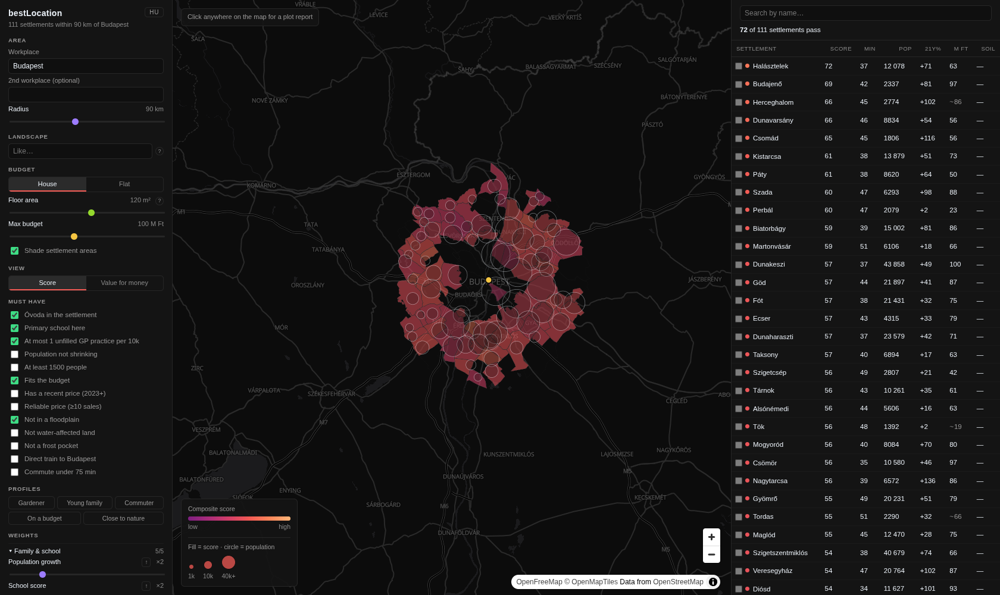

# bestLocation



A single-page map that ranks all 3,178 Hungarian settlements (towns, villages and the 23
Budapest districts) by a weighted mix of 20 public metrics: schools, commute, house and
flat prices, population trend, air quality, climate, terrain, soil, land cover and more.
You set the weights, the hard filters and a workplace; the map and the table re-rank as
you move a slider. Clicking any point on the map samples that exact spot (terrain, flood
indicators, nearby pollution sources) for a plot-level report.

The product language is Hungarian. On the first visit the UI follows the browser language
(Hungarian for a Hungarian browser, English otherwise), and a toggle switches it. Code,
comments and commits are English.

## What it does

- **Weighted ranking.** Each metric becomes a rank percentile within the current area, and the
  score is the weighted mean of the enabled metrics. Missing data abstains instead of scoring
  zero, so a village with no measured school is not punished for it. Five one-click profiles
  (gardener, young family, commuter, budget, close to nature) set the weights.
- **Hard filters.** 13 yes/no constraints: an óvoda in the settlement, a primary school, at most
  one unfilled GP practice per 10k people, fits the budget, not in a floodplain, and so on.
- **Workplaces.** One or two workplaces. The radius and the commute are measured from them;
  with two, the longer commute is ranked.
- **Value for money.** A second view fits score against log price and ranks settlements by how
  far they sit above that line.
- **Comparison.** Two to five settlements side by side, with ranks within the current area.
- **Plot report.** A click anywhere returns what is known about that point, not just about
  its settlement.
- **Opinions online.** For the Budapest districts, a short Hungarian summary of what forum
  users say about living there, with links to the threads (see the caveats below).

## Architecture

```
upstream sources ──> tools/fetch_*.py ──> data/out/settlements.json ──> tools/build_app_data.py
 (KSH, OSM, ESA,      one script per        the "spine": one record      trims it to the fields
  PVGIS, GTFS …)      source; each one      per settlement, keyed by     the page needs
                      decorates the spine   the KSH settlement code
                                                                     ┌──> app/   static page, no build step
                                         data/out/app_data.json ─────┤
                                                                     └──> tools/serve.py   stdlib HTTP server
                                                                            /api/anchor  commute times from a workplace
                                                                            /api/plot    point sample for the plot report
```

- `app/` is plain JavaScript loaded in order by `index.html`, with no framework and no
  bundler. MapLibre GL comes from a CDN and the basemap from OpenFreeMap.
  - `config.js` holds `METRICS` and `FILTERS`, the two tables that define the product.
  - `score.js` is the scoring math, DOM-free so it can be tested headless.
  - `lang.js` is the Hungarian string table; English is the inline fallback.
  - `app.js` is rendering, the map and the handlers.
- `tools/serve.py` is `http.server` plus two JSON routes. It binds to `127.0.0.1` and serves
  only `app/` and the three data files the page loads.
- `tools/commute.py` computes morning commutes to any workplace from the MÁV and BKK GTFS
  timetables (rail with at most one change, Budapest transit with at most one transfer, or a
  road estimate) and caches the result per workplace.
- `tools/build_all.sh` is the rebuild order, and the only place it is written down.

## Run it with the sample data

A fresh clone serves the committed sample in `data/sample/`: the 111 settlements within 30 km
of central Budapest (the 23 districts and their ring), cut from a full build of the pipeline.

```sh
python3 -m venv .venv
./.venv/bin/pip install -r requirements-runtime.txt
./.venv/bin/python tools/serve.py          # http://127.0.0.1:8731/app/index.html
```

When `data/out/app_data.json` does not exist, the server says so and serves the sample.
What the sample leaves out, and how the app shows it:

| Missing in the sample | Why | In the app |
|---|---|---|
| Soil (pH, texture, organic matter, garden score) | the TAKI soil service declares no licence | the soil column is empty and the metric abstains |
| Floodway, floodplain, water-affected land, distance to rivers and lakes | the OVF water layers need written permission to redistribute | those rows are left out; the floodplain filter passes everything |
| Rail and transit commutes | the timetables are not in the repository | every commute is the road estimate: crow-flies distance at 55 km/h plus 20 minutes |
| Broadband coverage, the nearest rail station | not shipped | those plot-report sections are hidden |

The plot report samples terrain live from the AWS terrain tiles. The live soil call to the
TAKI server is off by default; `SOIL_LIVE=1` turns it on for your own use.

### Docker

The image is the runtime only; `data/` is mounted, not copied.

```sh
docker build -t bestlocation .
docker run --rm -p 127.0.0.1:8731:8731 -v "$PWD/data:/app/data:ro" bestlocation
```

With a full build, also mount `data/out/commute` and `data/raw/terrain` read-write
(`-v "$PWD/data/out/commute:/app/data/out/commute"`, and the same for terrain) and run with
`--user "$(id -u):$(id -g)"`. The server writes its commute cache and downloaded terrain tiles
there; on a read-only mount a new workplace fails and the terrain section comes back empty.

## Rebuild the full dataset

```sh
python3 -m venv .venv
./.venv/bin/pip install -r requirements.txt
sh tools/build_all.sh              # full rebuild, in dependency order
PY=echo sh tools/build_all.sh      # dry run: print the steps
```

Most fetchers download their own source. These inputs need a manual step first (more detail
in `docs/data-sources.md`):

| Input | Where it goes | How |
|---|---|---|
| OSM-HU administrative boundaries, `https://data2.openstreetmap.hu/hatarok/kozighatarok.zip` | `data/raw/kozighatarok/` | download and unzip there (the shapefiles land in `data/raw/kozighatarok/kozighatarok/`) |
| National competency measurement, `https://www.oktatas.hu/pub_bin/dload/kozoktatas/OKM_adatvizualizacio/OKM_teljes_adatbazis_feladatellatasi_helyekre_2025.xlsx` | `data/raw/okm_2025.xlsx` | download with a browser (the server rejects HEAD requests and non-browser clients) |
| KIR school and óvoda sites, `https://kir.oktatas.hu/download/kozerdeku/kir_mukodo_feladatellatasi_helyek_2026_08_30.xlsx` | `data/raw/kir_sites.xlsx` | download |
| NMHH unserved-address survey (xlsx, published 2025-12-15) | `data/raw/nmhh_unserved_fixed.xlsx` | download from NMHH; no stable URL is recorded |
| ESA WorldCover 2021 tiles | `data/raw/worldcover/` | `sh tools/dl_worldcover.sh` |
| OSM polluting point sources | `data/raw/osm_pollution/{landfill,quarry,wwtp,works}.json` | Overpass exports of `landuse=landfill`, `landuse=quarry`, `man_made=wastewater_plant` and named `man_made=works`; the query itself is not in the repository |
| MÁV/GYSEV GTFS timetable | `data/raw/gtfs/mav/*.txt` | MÁV's request form (free, after registration); expect days of latency |

Everything else is downloaded by the scripts: KSH (place register, census, prices, crime),
Wikidata, OKFŐ, OVF, TAKI, PVGIS, NASA POWER, Open-Meteo, the terrain tiles and the BKK
timetable (`tools/commute.py --fetch`). A full build is about 1 GB under `data/raw/`. Several
of these sources (TAKI, OVF, NMHH, the timetables) carry no redistribution licence: keep
what they give you local. See the licence table below.

`tools/build_sample.py` cuts `data/sample/` out of a full build.

## Checks

```sh
node tools/test_score.mjs     # 28 checks: scoring math, summaries, language default
sh tools/check.sh             # the above, a Python compile check, and a headless-browser
                              # smoke test when the server answers on :8731
```

The smoke test is `tools/capture.mjs` (Playwright). It loads the app, takes a screenshot, and
exits non-zero on a console error, a failed request or an empty table. It needs `npm ci` and
`PLAYWRIGHT_BROWSERS_PATH=./.pw-browsers npx playwright install chromium` once.

Most `fetch_*.py` scripts also have a `--check` self-test. These are build verification, not
unit tests: they rewrite `data/out/settlements.json` and need the raw data or a live upstream.

## Data sources and licences

The code is MIT-licensed (see `LICENSE`). The data is not covered by that licence: each source
keeps its own terms, listed below.

`data/sample/` contains OpenStreetMap-derived data (settlement boundaries, distances to
pollution sources), so the sample, as a database, is available under the
[Open Database License 1.0](https://opendatacommons.org/licenses/odbl/1-0/), with the
attributions below. The crime figures in it may be non-commercial only (see their row).

| Layer | Source and attribution | Licence or terms | In the sample |
|---|---|---|---|
| Settlement boundaries | © OpenStreetMap contributors, via OSM-HU | ODbL 1.0 | yes |
| KSH code ↔ OSM crosswalk | Wikidata | CC0 | used to build it |
| Names, counties, areas | KSH Helységnévtár | CC BY 4.0 | yes |
| Census 2001/2011/2022 | KSH | CC BY 4.0 | yes |
| House and flat prices | KSH Ingatlanadattár (NAV-recorded sales) | CC BY 4.0 | yes |
| Recorded crime, county level | KSH STADAT iga0008 | disputed: CC BY 4.0 on ksh.hu, CC BY-NC in the national data catalogue; treat as non-commercial | yes |
| School results, schools, óvoda places | Oktatási Hivatal (OKM, KIR) | public-sector data, no licence declared | yes |
| Unfilled GP and dental practices | OKFŐ Alapellátási Igazgatóság | public-sector data, no licence declared | yes |
| Elevation, slope, aspect, frost pockets | AWS Terrain Tiles (Mapzen/Tilezen; EU-DEM, SRTM, GMTED and others) | open, with attribution | yes |
| Land cover | © ESA WorldCover project 2021 / Contains modified Copernicus Sentinel data (2021) processed by ESA WorldCover consortium; resampled to 100 m | CC BY 4.0 | yes |
| Air pollution (PM2.5, NO₂) | Contains modified Copernicus Atmosphere Monitoring Service information (2024), via Open-Meteo | CC BY 4.0; Open-Meteo's free API tier is for non-commercial use | yes |
| Rainfall, wind, frost window | NASA POWER (MERRA-2) | free, with citation; no NASA endorsement implied | yes |
| Solar yield | PVGIS © European Communities, 2001-2026 | free, with attribution | yes |
| Polluting point sources | © OpenStreetMap contributors, via Overpass | ODbL 1.0 | yes |
| Opinions online | LLM-written summaries of public forum threads (gyakorikerdesek.hu, hoxa.hu), each linked | see below | yes |
| Soil | HUN-REN ATK TAKI, DOSoReMI | no licence declared | **no** |
| Flood and water layers | OVF, VIR | redistribution needs written permission | **no** |
| Rail and transit timetables | MÁV-START, GYSEV, BKK (GTFS) | not confirmed | **no** |
| Broadband coverage | NMHH | no redistribution without permission | **no** |
| Basemap | OpenFreeMap, OpenMapTiles, © OpenStreetMap contributors | ODbL | loaded live |

Two caveats that matter when reading the map:

- **The opinions are unverified.** "Opinions online" is an LLM-written summary of public forum
  discussion, collected once (2026-09-13) under the rules in `tools/opinion_research_prompt.md`.
  Nobody checked the claims made in the threads: read them as what people said, not as fact.
  They exist for the Budapest districts only.
- **Crime is county-level.** Settlement-level figures sit behind a personal government login,
  so every settlement in a county shows the same number. It separates regions, not villages,
  and its default weight is 0.

Every endpoint, with notes on what was verified: `docs/data-sources.md`.
